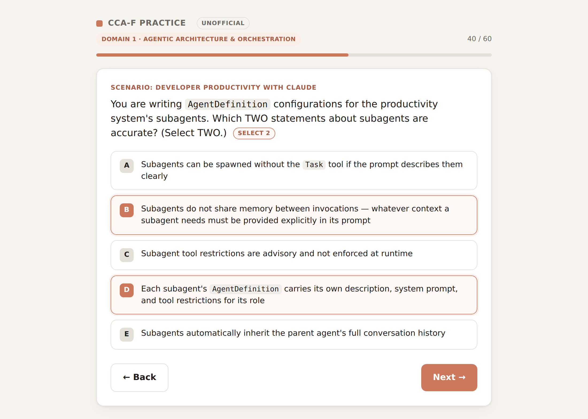
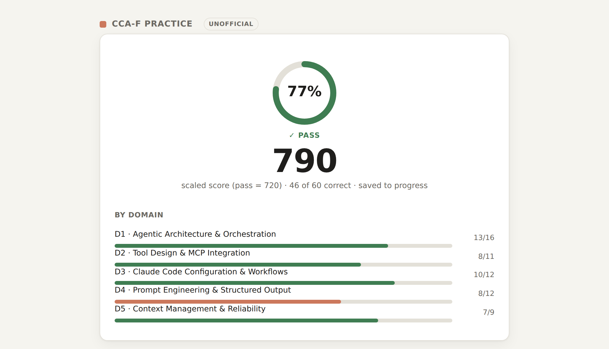

# CCA-F Practice

An unofficial, open-source practice exam for the **Claude Certified Architect – Foundations**
certification. Timed-exam feel, scenario-based questions, per-domain scoring, and a list of
missed questions that clears itself as you get them right.

**Try it:** https://vsouto.github.io/ccaf-practice/

| | |
|---|---|
|  |  |

> **Unofficial.** This project is not affiliated with, endorsed by, or sponsored by Anthropic.
> It contains **no real exam content**: every question was written from the publicly available
> exam guide's domains and task statements. Questions that reproduced the guide's own sample
> questions were removed. If you have taken the exam, please don't contribute anything you saw
> in it, because exam content is confidential under Anthropic's Certification Exam Policy.

## What it does

- **Exams by size.** 3, 5, 10, 20 or 40 questions, drawn at random and weighted by the five
  blueprint domains (27 / 18 / 20 / 20 / 15 %).
- **Full mock.** Matthew Purcell's 60-question set, run in scenario order like the real exam.
- **Multiple-response questions.** "Select TWO" items, scored all-or-nothing.
- **Scaled score.** A linear 100–1000 estimate with the 720 pass line, plus a per-domain breakdown
  and an explanation for every answer.
- **Progress tracking.** Score trend, cumulative domain accuracy, a readiness check, and a
  missed-questions list. Everything stays in your browser (`localStorage`); nothing is sent anywhere.

## Run it locally

Plain HTML and JavaScript. No build step, no dependencies.

```bash
git clone https://github.com/vsouto/ccaf-practice.git
cd ccaf-practice
python3 -m http.server 8765
# open http://127.0.0.1:8765/
```

Opening `index.html` directly from disk works too.

Keyboard: `1`–`5` pick an answer, `→`/`Enter` next, `←` back.

## Question banks

| File | Questions | Author |
|---|---|---|
| `questions.js` | 44 | Victor Souto: the original set |
| `quiz-new8.html` | 8 | Victor Souto: gap-fill quiz |
| `questions-alter77.js` | 65 | [Olivier Legris / Alter](https://github.com/OlivierAlter/Claude-Certified-Architect-Foundations-Certification-Exam) |
| `questions-purcell60.js` | 60 | [Matthew Purcell](https://www.linkedin.com/in/purcellmatthew) |

Every question has the same shape:

```js
{ id, domain /* 1-5 */, scenario, question, options, correct, explanation }
```

`correct` is an option index, or an array of indices for multiple-response items. Each bank
file is optional: delete one and the app keeps working with the rest.

## License

The app code and Victor Souto's questions are MIT-licensed (see `LICENSE`). The Alter and
Purcell question sets remain the work of their authors. They are included with attribution and
are not covered by the MIT license. Authors who would like their set removed or credited
differently can open an issue.

"Claude" and "Anthropic" are trademarks of Anthropic, PBC. They are used here only to name the
certification this project helps you prepare for.
